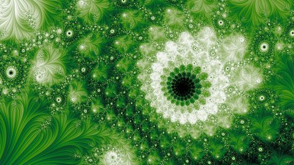
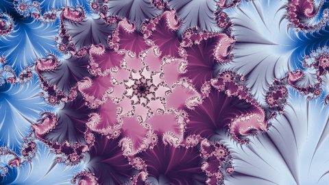
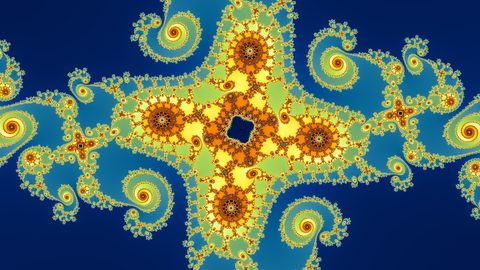

# fractal-wallpapers

This repository makes fractal wallpapers. It searches the Mandelbrot set and its
relatives for places worth framing, renders each place in many colorings and palettes,
and lets small neural judges trained on human ratings choose a gallery from the results.
It is the pipeline behind the site [Making Fractal Wallpapers](https://techmatt.github.io/fractals/).

<p align="center">
  <a href="https://techmatt.github.io/fractals/explorer/index.html?v=4&m=stripe&x=-1.2514947263705116&y=0.04110851135180772&w=0.0000000798119929768514&p=cmr.jungle&mirror=1"></a>
  <a href="https://techmatt.github.io/fractals/explorer/index.html?v=4&f=phoenix&cx=-0.45709691767279576&cy=-0.199309339142123&px=0.26195066562519664&py=-0.03188285542142037&zx=0.23987361417464126&zy=0.45066347511034605&m=threads&x=1.1154713756796277&y=0.1372761613815802&w=0.0006723781020213695&p=Sapphire%20Against%20Rose"></a>
  <a href="https://techmatt.github.io/fractals/explorer/index.html?v=4&f=julia4&cx=0.44637678855595264&cy=0.6581861161102234&x=-0.0006944498037232774&y=-0.007170259608518661&w=0.644829668143998&p=glowdon&phase=0.053"></a>
  <a href="https://techmatt.github.io/fractals/explorer/index.html?v=4&f=julia3&cx=0.4169190761394084&cy=0.006933824661843332&m=threads&x=-0.054828545370623066&y=0.017335365897850258&w=0.251946210734878&p=Cobalt%20Furnace%20Ultra&phase=0.95781"></a>
</p>

**Where to go:**

- [The site](https://techmatt.github.io/fractals/): the article on how it was made
- [Mandelnaut Explorer](https://techmatt.github.io/fractals/explorer/): fly through the fractals in your browser
- [Wallpaper packs](https://techmatt.github.io/fractals/wallpaper-packs/): the wallpapers, to download
- [Run the pipeline yourself](https://techmatt.github.io/fractals/tools-and-data/run-it-yourself/):
  a worked example of [this repository's path](#from-a-fresh-clone-to-a-first-gallery),
  with sample output from every stage
- [`FORMATS.md`](FORMATS.md): every file the pipeline writes, field by field
- [techmatt/fractals](https://github.com/techmatt/fractals): the website's source

**Licences:** the code is MIT; the wallpapers are CC BY 4.0, credit Matt Fisher
([details](#license)).

[](https://github.com/techmatt/fractal-wallpapers/actions/workflows/ci.yml?query=branch%3Amain)

## What it does

The search covers the Mandelbrot set, multibrots of degree 3 to 6, Julia sets of degree 2
to 6, the Phoenix set, and a render-only fractional multibrot, drawn in about twenty
coloring modes through about a thousand palettes.

Four judges pick from that space. Three are trained on human ratings tracked in this
repository; the palette judge is distilled from an older palette model.

| judge | what it scores |
| --- | --- |
| `location` | whether a place is worth rendering at all |
| `render`, the wallpaper judge | whether a particular rendering of a place is good |
| `palette` | which palette suits a place |
| `gallery_grade`, the gallery judge | a finer order inside the render judge's top band |

The output is a gallery of a few hundred to a thousand wallpapers, chosen for quality and
for spread across family, color, and structure.

## How this relates to techmatt/fractals

This repository is the pipeline; [techmatt/fractals](https://github.com/techmatt/fractals)
is the site that presents it. Mandelnaut Explorer runs this engine compiled to
WebAssembly. Every wallpaper carries its explorer link in its metadata, so any of them
reopens in the explorer, and any explorer view can be rendered here at full size.

## What is where

- `engine/`: the Rust renderer, including `render-link`
- `src/fractal_wallpapers/`: the Python side, one package per stage
  - `discovery/` and `supply/`: the search over the complex plane, and how its time is split
  - `deep/`: the same search below the ordinary walk's depth
  - `palettes/` and `coloring/`: the palette library, and the tone a finished render is held to
  - `labeling/`: the rig that collects human ratings
  - `models/`: the judges, and how each is trained and accepted
  - `curation/`: the candidate pool, the legs that fill it, and the gallery solve
  - `cli/`: the `fractal-wallpapers` command, one module per command group
- `data/`: the tracked records: labels, palettes, and the stores the stages read
- `models/`: each judge's tracked metadata; its weights are fetched beside it
- `tests/`: the suite, and what each guard is for
- `examples/`: the four pictures above

Every directory has a README beside the code it explains. There is no `docs/` tree.

## Requirements

* **Python 3.11+.**
* **Rust 1.85+**, from [rustup](https://rustup.rs).
* **A linker for Rust**: on Windows, the `Desktop development with C++` workload of
  [Visual Studio Build Tools](https://visualstudio.microsoft.com/visual-cpp-build-tools/);
  on macOS, the Xcode Command Line Tools (`xcode-select --install`); on Linux, a C
  compiler (`build-essential` or your distribution's equivalent).
* **A GPU only to train.** Rendering, the search, and choosing a gallery don't use one.

Windows x86_64, Linux x86_64, and macOS on Apple silicon are supported, and CI runs the
full suite on all three. Intel Macs can render, search, and choose a gallery, but can't
install the `models` extra, because torch publishes no macOS x86_64 wheel. Background
priority for render workers is a Windows feature; elsewhere, put `nice` in front of a long
run.

## Install

The code is Rust and Python. The Rust engine in `engine/` draws every picture, and it can
be built and used alone for rendering (`cargo build` and step 1's `render-link` need
nothing else). Python runs the pipeline around it and the judges, which are PyTorch models.

**[`uv`](https://docs.astral.sh/uv/) is the primary route**, and it's what CI runs. Pick
CPU or CUDA; the two differ only in which torch they install:

```
git clone https://github.com/techmatt/fractal-wallpapers
cd fractal-wallpapers
uv sync --extra models --extra solve              # CPU torch, any machine
uv sync --extra cuda --extra solve                # or: CUDA torch, an NVIDIA card (Windows, Linux x86_64)
cargo build --release --manifest-path engine/Cargo.toml
.venv/Scripts/fractal-wallpapers fetch-weights    # Linux/macOS: .venv/bin/fractal-wallpapers
```

- **One `uv sync`, not both.** `models` and `cuda` are declared as conflicting, so a
  second sync swaps the torch in place. Add `--extra dev` for the test suite and the
  linter. `uv sync` makes `.venv` itself, picking a Python that every pinned wheel
  supports. On a Windows 10 box on 2026-10-04, CPU landed on Python 3.13 with torch
  2.14.1+cpu (a 0.75 GB venv, about 40 s), and CUDA on Python 3.12 with torch
  2.6.0+cu124 (a 4.7 GB venv, about 50 s). The `uv.lock` it writes is ignored.
- **Every command below is `fractal-wallpapers …`.** Activate the venv once
  (`.venv\Scripts\activate` on Windows, `source .venv/bin/activate` elsewhere), or prefix
  each command with `.venv/Scripts/` (`.venv/bin/`).
- **Rust** builds the engine in about a minute. Build it in release; a debug build runs
  about ten times slower.
- **`fetch-weights`** downloads the four judges (43 MB) from this repository's GitHub
  release named in `models/weights.json`, and checks each file against its sha256.
- **What downloads on first use:** `curate embed` fetches a frozen DINOv2 ViT-S/14
  ([`timm/vit_small_patch14_dinov2.lvd142m`](https://huggingface.co/timm/vit_small_patch14_dinov2.lvd142m),
  85 MB, Apache-2.0) into the Hugging Face cache, `~/.cache/huggingface` unless `HF_HOME`
  says otherwise. Nothing else needs the network after install.

**The alternative is pip**, for a machine without uv. It gets CPU torch from PyPI on
Windows and macOS, so use it for CPU only; [`models/README.md`](src/fractal_wallpapers/models/README.md)
gives the CUDA pip command and why uv is the better way there:

```
python -m venv .venv
.venv/Scripts/pip install -e ".[models,solve]"   # Linux/macOS: .venv/bin/pip
```

`pip install -e .` alone is the base install: the engine, the search and the labeling rig,
with no torch. A command that needs an extra you don't have says which one.

| extra | for |
| --- | --- |
| `models` | running and training the judges (torch, torchvision, timm), on CPU torch |
| `cuda` | `models` on CUDA torch, for an NVIDIA card |
| `solve` | choosing a gallery (numpy, pillow) |
| `dev` | the test suite and the linter |

Rendered output goes under `artifacts/`, which in real use reaches a hundred gigabytes or
so. An untracked `local.toml` can move it to another disk; the
[package README](src/fractal_wallpapers/README.md) explains how.

## From a fresh clone to a first gallery

A worked example of this path, with sample output from every stage, is at
<https://techmatt.github.io/fractals/tools-and-data/run-it-yourself/>.

One ordered path, about half an hour end to end. Every step is one command, writes the
files named beside it (each field is in [`FORMATS.md`](FORMATS.md)), and leaves one page
to open that shows the result is sane. Every page has a `page.json` beside it holding
exactly what it shows ([FORMATS.md](FORMATS.md#pagejson)), names the command that made it
at the top, and takes `--bundle DIR` to write itself as a folder that can leave the clone.
Step 10 gathers them all. Times are from a sample run on the box in
[*What each stage costs*](#what-each-stage-costs).

**1. Render one picture** (about a minute, then seconds):

```
fractal-wallpapers render --family mandelbrot --center-re -0.7436438870371587 \
  --center-im 0.13182590420531197 --width 0.00001 --mode stripe --cycles 2 --out artifacts/first.png
engine/target/release/fractal-engine render-link --size 2560x1440 --out artifacts/seat.png \
  --link "https://techmatt.github.io/fractals/explorer/?v=4&f=julia&cx=-1.2540170796954613&cy=-0.07161459637319667&m=tia&x=-0.336363658629224&y=-0.06271709146615745&w=0.5659066537374874&p=Oxblood%2C%20Cyan%2C%20Cream&phase=0.597858"
```

The first spells the picture out in flags; it is a deep view with a lot of interior, so
it takes about 70 s on the reference box. The second draws an explorer link, copied from
the explorer or from any wallpaper's metadata, in about 5 s. The link is read as text: it
is a complete recipe, and nothing is fetched from the network. `render-link` needs no
Python and no weights, and it embeds the link in the file, so the picture reopens its view
when dropped on the explorer. Every family, mode, palette and number either can set, with
its default and range, is in step 10's `parameters.json` and in `render --help` and
`fractal-engine render-link --help`. Writes the two PNGs; open them.

**2. Check the install** (under a minute):

```
fractal-wallpapers judges check
```

This renders eight tracked recipes and holds each to two halves. **The picture matches**:
every cell of a 32x18 grid has its mean colour within 4 of 255 of a tracked text
reference, since the engine draws the same picture everywhere but promises no byte
identity across machines. **The scores match**: all four judges within 1e-4 of the
expected scores (CPU and CUDA agree to about 1e-5). It exits non-zero if either misses,
and times each render beside the reference box's time, so you can calibrate your
machine. Writes `artifacts/judges/check/check.json`. Open
`artifacts/judges/check/index.html`. `judges score <picture>…` scores any picture of your
own.

**3. Search the planes for places** (10 minutes, then about 3 to score):

```
fractal-wallpapers harvest --minutes 10 --no-scoring
fractal-wallpapers curate score --harvest artifacts/harvest
fractal-wallpapers harvest export
fractal-wallpapers harvest stats
```

The harvest walks all twelve fractal families and writes `artifacts/harvest/walk.jsonl`
([FORMATS.md](FORMATS.md#walkjsonl)). The two degree-6 families, which no human has
labelled, share at most a tenth of a mixed harvest's clock
(`supply.allocation.CAPPED_GROUP_SHARE`), so the cheapest family cannot take over a
first walk. `curate score` reads every admitted place through the location judge into `artifacts/curation/supply_scores.jsonl`
([FORMATS.md](FORMATS.md#supply_scoresjsonl)). `export` joins the two into one flat
`artifacts/harvest/locations.jsonl` ([FORMATS.md](FORMATS.md#locationsjsonl)), one row a
place, and `stats` prints each family's places and scores. Open
`artifacts/harvest/stats/index.html` for each family's best four and worst four places.

**4. Embed the places** (1.5 minutes on CUDA, about 6 on CPU):

```
fractal-wallpapers curate embed
```

This is a hard gate: a hunt refuses to start without it. On first use it downloads DINOv2
(see *Install*). It writes the embedding store under `artifacts/curation/`, and it has no
page.

**5. Render candidates, and merge them into the pool** (10 minutes):

```
fractal-wallpapers curate hunt run --name h1 --budget 600 --unconditional 600
fractal-wallpapers curate hunt merge --name h1
fractal-wallpapers curate candidate-ledger browse
```

`--budget` is render-seconds, which in practice is wall time; ten minutes made 327
candidates over 109 places. The hunt renders each place in several modes and palettes at
640x360 and scores every picture with the render judge.
`merge` puts the rows into the candidate pool,
`artifacts/curation/candidate_ledger/{rows,scores}.jsonl`
([FORMATS.md](FORMATS.md#candidate-ledger-rows)). Open
`artifacts/curation/candidate_page/index.html` for the pool by mode and family, its best
candidates and a random draw. Its gallery-judge column fills once step 6 has run; run
`browse` again then to see it.

**6. Read the pool with the gallery judge** (seconds):

```
fractal-wallpapers gallery-grade score-pool
```

The solve's order needs this, and it needs it again after every merge. It writes
`artifacts/gallery_grade_head/pool_scores.jsonl` ([FORMATS.md](FORMATS.md#pool_scoresjsonl)).

**7. Choose a gallery** (1 to 3 minutes at n=12, most of it rendering the seats at 1280x720):

```
fractal-wallpapers curate solve run --name first --n 12 --force-fill
fractal-wallpapers curate solve run --name first_at_bars --n 12
```

`--force-fill` is the first look at an early pool. The quality bars stop refusing, and the
best rows available seat under every distinctness rule. Without it, the default bars seat
only the handful a short run clears (see below): 2 of 12 in the sample run, against 12 of
12 forced, and 4 of 12 after step 9's five-minute mine. Each run writes
`artifacts/curation/solve/<name>/solve.json` ([FORMATS.md](FORMATS.md#solvejson)) and the
seats at 1280x720. Open `artifacts/curation/solve/<name>/contact_sheet.html`.

**8. Record it, and open the viewer** (the same, plus seconds):

```
fractal-wallpapers curate solve record --n 12 --force-fill
fractal-wallpapers curate solve browse --viewer
```

A record is the solve run once more and kept under a UTC stamp that never moves:
`artifacts/curation/tentative/<stamp>/{gallery.jsonl,manifest.json}`
([FORMATS.md](FORMATS.md#galleryjsonl)). It goes on the keep list, so a later merge spares
its pictures; `curate solve release <stamp>` lets it go. `browse --viewer` writes the
newest record you made to `artifacts/curation/viewer/index.html`, the page to open. Its
`page.json` is [FORMATS.md](FORMATS.md#gallery-pagejson)'s.

**9. Keep the pool growing** (as long as you like):

```
fractal-wallpapers curate mine run --name m1 --budget 300
fractal-wallpapers curate mine merge --name m1
fractal-wallpapers gallery-grade score-pool
fractal-wallpapers curate solve run --name second --n 12
```

A mine spends its budget where the pool is thinnest. Re-score and re-solve after each
merge.

**10. Trace the gallery, and gather every page** (about a minute and a half, nearly all of it step 1's renders):

```
fractal-wallpapers curate solve trace <stamp>
fractal-wallpapers walkthrough --stamp <stamp>
```

`trace` follows each seat of a record back through every file above, to the walk row that
found its place, and follows three of each kind of reject to where it stopped. It writes
`artifacts/curation/trace/<stamp>/`: sliced copies of each file holding only the rows on
those chains, `counts.json` with each full file's size ([FORMATS.md](FORMATS.md#countsjson)),
and `index.html`, which shows each seat's row from every file with the join field marked.
`walkthrough` writes every page of this path into `artifacts/walkthrough/`, each a folder
holding its page, its `page.json` and only the pictures it shows: `judges-check/`,
`walk-stats/`, `candidates/`, `gallery/` and `trace/`, plus the harvest's `summary.json`,
`stats.json`, `keep.jsonl` and an `index.html` linking them all. Open that. Beside them
are `render/` (step 1's two pictures, drawn again and timed on your machine),
`parameters.json` ([FORMATS.md](FORMATS.md#parametersjson)) and `help/`, every command's
`--help`. Nothing else is rendered; a page whose step was skipped is listed with the
command that makes it. In the sample run the five folders came to 0.18, 1.57, 0.79, 0.23
and 1.27 MB, and the whole folder to 4.85 MB, 0.55 MB of it `render/`.

### Say it plainly

- **A harvest is clock-allocated, so no two runs match.** Slots go to whichever family is
  furthest below its share at that moment, priced by measured minutes, so even at one seed
  two runs diverge within a few batches. Only the seeded draws inside a run are
  reproducible.
- **A merge prunes, and it deletes pictures.** Each merge keeps the best few rows per
  (place, mode) and deletes the rest with their pictures, unless a record on the keep list
  (step 8) or a published record seats them. It also rewrites the tracked manifests under
  `data/curation/`, so `git status` goes dirty after every merge. That is the record
  keeping up, not damage.
- **A short run seats few pictures at the default bars.** A seat has to clear its mode's
  bar on the render judge, then the gallery judge's fine bar, and only a few percent of a
  ten-minute pool clears both. A gallery of hundreds wants hours of mining. `--force-fill`
  shows what the pool holds today, and its record says it ran forced.
- **A clone holds the published records as text only.** The twenty-one galleries under
  `artifacts/curation/tentative/20260922T*` are their rows, manifests and recipes, with no
  pictures. `render --recipe <recipes.jsonl> --key <alias>` draws any seat of them.

### What each stage costs

Measured on 2026-10-04 on one box (Intel i5-10400F, NVIDIA RTX 2060 SUPER, Windows 10),
in a fresh clone that followed this path. Engine times cover the eight `judges check`
recipes rendered at each geometry; judge times are inference only, with the model already
loaded, at the batch size the pipeline uses. Model load is a fraction of a second apiece,
except the first torch import (about 4 s).

| stage | rendered at | the network reads | engine s / picture | judge ms / picture, CPU · CUDA | bytes / picture | in the sample run |
| --- | --- | --- | --- | --- | --- | --- |
| walk frame (gate render) | 384x216, ss1 | — | 0.04–0.3 | — | 60 KB | 4,069, 246 MB |
| location judge | its own 384x216 ss1 view | 384x224 stretch | 0.04–0.3 | 24 · 5 | 60 KB | 4,022, 241 MB |
| embedding (DINOv2) | 448x252, ss1 | 448x252 as is | 0.05–0.2 | 100 · 8 | 90 KB | 1,796, 155 MB |
| mined candidate | 640x360, ss2 | — | 0.2–1.2 | — | 140 KB, plus about 0.9 MB of cached field | 437 rows after two merges, 81 MB of pictures, 317 MB of fields |
| wallpaper (render) judge | the candidate | 384x224 stretch | — | 13 · 7 | — | every candidate |
| gallery judge | the candidate | 384x224 stretch, 3 seeds | — | 25 · 8 | — | the above-bar rows |
| palette judge | 640x360, ss2 | 224x224 squash | — | 9 · 6 | — | `judges check` only |
| solve seat | 1280x720, ss2 | — | 0.7–4.1 | — | 1.8 MB PNG | 12 a solve, 34 MB for three solves and two records |
| full-size wallpaper | 2560x1440, ss3 | — | 5–31 | — | 2.2 MB JPEG | not made |

A GPU speeds the judges up 2 to 12 times. The embedding gains most (100 ms to 8 ms a
picture, so `curate embed` took 102 s here, against about 380 s for the audit's CPU
install), then the location judge. Everything that renders is engine-bound on either
install, at three below-normal workers: the harvest, the hunt, the mine and the seat
renders take the same wall time, and a fixed hunt budget makes about a fifth more
candidates on CUDA only because its judging overhead is smaller (1.5 s against 1.9 s a
candidate). The 10 + 10 minute sample took about 27 minutes from harvest to viewer on
the CUDA install, and the 5-minute mine, its merge and the re-solve about 6 more. It leaves
about 1.1 GB under `artifacts/`, and step 10's walkthrough is 4.85 MB of it. The first CPU
sample of 2026-10-04 took about 45 minutes and landed on the same order of disk.

Each stage's README covers the rest:

| stage | read |
| --- | --- |
| finding places | [`discovery/`](src/fractal_wallpapers/discovery/README.md), [`supply/`](src/fractal_wallpapers/supply/README.md) |
| collecting ratings | [`labeling/`](src/fractal_wallpapers/labeling/README.md) |
| training the judges | [`models/`](src/fractal_wallpapers/models/README.md) |
| rendering more of the places already found | [`curation/LEGS.md`](src/fractal_wallpapers/curation/LEGS.md) |
| choosing a gallery | [`curation/GALLERY.md`](src/fractal_wallpapers/curation/GALLERY.md) |

## How it works

The Rust crate in `engine/` renders every pixel, and Python reaches it only through
`src/fractal_wallpapers/engine.py`. The crate has no platform-specific code, so it compiles
to `wasm32-unknown-unknown` unmodified.

Records are JSONL, and every row carries an integer `schema` field. A label row carries the
label and the complete render parameters together, so a labeled example is never split
across two files. Every random draw is seeded, and the seed is recorded with the result.

## License

The code is MIT; see [`LICENSE`](LICENSE). The judges' weights are MIT too. The wallpapers
are [CC BY 4.0](https://creativecommons.org/licenses/by/4.0/): use them for anything, with
credit to Matt Fisher.

The DINOv2 encoder is third party, Apache-2.0, and is fetched from Hugging Face rather than
redistributed here.
