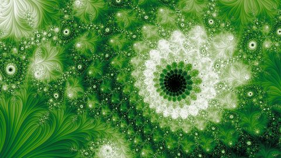
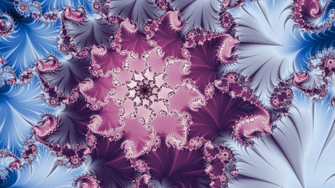
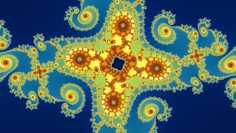

# fractal-wallpapers

This repository makes fractal wallpapers. It searches the Mandelbrot set and its
relatives for places worth framing, renders each place in many colorings and palettes,
and lets small neural judges trained on human ratings choose a gallery from the results.
It is the pipeline behind the site [Making Fractal Wallpapers](https://techmatt.github.io/fractals/).

<p align="center">
  <a href="https://techmatt.github.io/fractals/explorer/index.html?v=4&m=stripe&x=-1.2514947263705116&y=0.04110851135180772&w=0.0000000798119929768514&p=cmr.jungle&mirror=1"></a>
  <a href="https://techmatt.github.io/fractals/explorer/index.html?v=4&f=phoenix&cx=-0.45709691767279576&cy=-0.199309339142123&px=0.26195066562519664&py=-0.03188285542142037&zx=0.23987361417464126&zy=0.45066347511034605&m=threads&x=1.1154713756796277&y=0.1372761613815802&w=0.0006723781020213695&p=Sapphire%20Against%20Rose"></a>
  <a href="https://techmatt.github.io/fractals/explorer/index.html?v=4&f=julia4&cx=0.44637678855595264&cy=0.6581861161102234&x=-0.0006944498037232774&y=-0.007170259608518661&w=0.644829668143998&p=glowdon&phase=0.053"></a>
  <a href="https://techmatt.github.io/fractals/explorer/index.html?v=4&f=julia3&cx=0.4169190761394084&cy=0.006933824661843332&m=threads&x=-0.054828545370623066&y=0.017335365897850258&w=0.251946210734878&p=Cobalt%20Furnace%20Ultra&phase=0.95781"></a>
</p>

**Where to go:**

- [The site](https://techmatt.github.io/fractals/): the article on how it was made
- [Mandelnaut Explorer](https://techmatt.github.io/fractals/explorer/): fly through the fractals in your browser
- [Wallpaper packs](https://techmatt.github.io/fractals/wallpaper-packs/): the wallpapers, to download
- [Run the pipeline yourself](https://techmatt.github.io/fractals/tools-and-data/run-it-yourself/):
  a worked example of [this repository's path](#from-a-fresh-clone-to-a-first-gallery),
  with sample output from every stage
- [`FORMATS.md`](FORMATS.md): every file the pipeline writes, field by field
- [techmatt/fractals](https://github.com/techmatt/fractals): the website's source

**Licences:** the code is MIT; the wallpapers are CC BY 4.0, credit Matt Fisher
([details](#license)).

[](https://github.com/techmatt/fractal-wallpapers/actions/workflows/ci.yml?query=branch%3Amain)

## What it does

The search covers the Mandelbrot set, multibrots of degree 3 to 6, Julia sets of degree 2
to 6 and the Phoenix set, in about twenty coloring modes and a thousand palettes (a
render-only fractional multibrot is reached by [spec file](FORMATS.md#the-render-spec)).
Four judges pick; three are trained on tracked human ratings, the palette judge distilled
from an older model.

| judge | what it scores |
| --- | --- |
| `location` | is a place worth rendering |
| `render`, the wallpaper judge | is this rendering of it good |
| `palette` | which palette suits a place |
| `gallery_grade`, the gallery judge | a finer order in the render judge's top band |

The output: a gallery of hundreds, spread across family and color.

## How this relates to techmatt/fractals

[techmatt/fractals](https://github.com/techmatt/fractals) is the site; its explorer runs
this engine as WebAssembly. Every wallpaper's metadata carries its explorer link, and any
explorer view renders here at full size.

## What is where

- `engine/`: the Rust renderer
- `src/fractal_wallpapers/`: the Python side: `discovery/` and `supply/` (the search),
  `deep/` (below the walk's depth), `palettes/` and `coloring/`, `labeling/` (human
  ratings), `models/` (the judges), `curation/` (the pool and the gallery solve), `cli/`
- `data/`: tracked records: labels, palettes, stores, and `styles/` (named layer stacks
  for `fractal-wallpapers style render`)
- `models/`: each judge's tracked metadata; weights are fetched beside it
- `tests/`, and `examples/` (the four pictures above)

Every directory has a README; there is no `docs/`.

## Requirements

* **Python 3.11+.**
* **Rust 1.85+**, from [rustup](https://rustup.rs). On Windows use MSVC: the GNU
  toolchain runs 2 to 17 times slower (`rustup default stable-msvc`).
* **A linker**: Windows, the `Desktop development with C++` workload of
  [Visual Studio Build Tools](https://visualstudio.microsoft.com/visual-cpp-build-tools/);
  macOS, `xcode-select --install`; Linux, `build-essential`.
* **A GPU only to train.**

CI runs on Windows x86_64, Linux x86_64 and Apple-silicon macOS; Intel Macs lack only
the `models` extra.

## Install

The engine builds and renders alone (`cargo build`, step 1's `render-link`); Python runs
the pipeline and the PyTorch judges. **[`uv`](https://docs.astral.sh/uv/) is the primary
route** (what CI runs); CPU and CUDA differ only in torch:

```
git clone https://github.com/techmatt/fractal-wallpapers
cd fractal-wallpapers
uv sync --extra models --extra solve              # CPU torch, any machine
uv sync --extra cuda --extra solve                # or: CUDA torch, an NVIDIA card (Windows, Linux x86_64)
cargo build --release --manifest-path engine/Cargo.toml
.venv/Scripts/fractal-wallpapers fetch-weights    # Linux/macOS: .venv/bin/fractal-wallpapers
```

- **One `uv sync`, not both** (`models` and `cuda` conflict). `--extra dev` adds tests
  and linter. Commands below assume `.venv` is active. Build the engine in release.
- **`fetch-weights`** downloads the four judges (43 MB) from the release named in
  `models/weights.json` and checks each sha256.
- **On first use** `curate embed` fetches DINOv2 ViT-S/14
  ([`timm/vit_small_patch14_dinov2.lvd142m`](https://huggingface.co/timm/vit_small_patch14_dinov2.lvd142m),
  85 MB) into the Hugging Face cache (`HF_HOME`). Nothing else needs the network.

**pip is the CPU-only alternative**
([`models/README.md`](src/fractal_wallpapers/models/README.md) has CUDA):

```
python -m venv .venv
.venv/Scripts/pip install -e ".[models,solve]"   # Linux/macOS: .venv/bin/pip
```

`pip install -e .` alone is the torch-free base: engine, search, labeling rig. Extras:
`models` (the judges on CPU torch), `cuda` (the same on CUDA), `solve` (choosing a
gallery), `dev` (tests and linter); a command missing one says which. Output goes under
`artifacts/` (~100 GB in real use); an untracked `local.toml` can move it
([package README](src/fractal_wallpapers/README.md)).

## From a fresh clone to a first gallery

A worked example of this path, with sample output from every stage, is at
<https://techmatt.github.io/fractals/tools-and-data/run-it-yourself/>.

About half an hour. Each step writes the files named (fields in [`FORMATS.md`](FORMATS.md))
and a page with a `page.json` twin ([FORMATS.md](FORMATS.md#pagejson)); `--bundle DIR`
makes it portable. Times: [*What each stage costs*](#what-each-stage-costs).

**1. Render one picture** (seconds):

```
fractal-wallpapers render --family julia --c -0.75 0.11 --center-re 0 --center-im 0 --width 3 --mode stripe --cycles 2 --out artifacts/first.png
engine/target/release/fractal-engine render-link --size 2560x1440 --out artifacts/seat.png \
  --link "https://techmatt.github.io/fractals/explorer/?v=4&f=julia&cx=-1.2540170796954613&cy=-0.07161459637319667&m=tia&x=-0.336363658629224&y=-0.06271709146615745&w=0.5659066537374874&p=Oxblood%2C%20Cyan%2C%20Cream&phase=0.597858"
```

The first spells a quadratic Julia set out in flags (about 3 s). The second draws an
explorer link, copied from the explorer or any wallpaper's metadata (about 5 s): a
complete recipe read as text, nothing fetched, no Python or weights needed. It embeds the
link, so the picture reopens its view when dropped on the explorer. Every settable knob,
with default and range, is in step 10's `parameters.json` and each command's `--help`.

**2. Check the install** (under a minute):

```
fractal-wallpapers judges check
```

Eight tracked recipes must match their reference picture (each 32x18 grid cell's mean
colour within 4 of 255) and all four judges' scores (within 1e-4), or it exits non-zero. Writes
`artifacts/judges/check/check.json`; open `artifacts/judges/check/index.html`.
`judges score <picture>…` scores your own pictures.

**3. Search the planes for places** (10 minutes, then about 3 to score):

```
fractal-wallpapers harvest --minutes 10 --no-scoring
fractal-wallpapers curate score --harvest artifacts/harvest
fractal-wallpapers harvest export
fractal-wallpapers harvest stats
```

The harvest walks the twelve families into `artifacts/harvest/walk.jsonl`
([FORMATS.md](FORMATS.md#walkjsonl)); `curate score` reads each place through the
location judge into `artifacts/curation/supply_scores.jsonl`
([FORMATS.md](FORMATS.md#supply_scoresjsonl)); `export` joins them into
`artifacts/harvest/locations.jsonl` ([FORMATS.md](FORMATS.md#locationsjsonl)). Open
`artifacts/harvest/stats/index.html` for each family's best and worst places.

**4. Embed the places** (1.5 minutes on CUDA, about 6 on CPU):

```
fractal-wallpapers curate embed
```

A hunt refuses to start without it. Fetches DINOv2 once (see *Install*).

**5. Render candidates, and merge them into the pool** (10 minutes):

```
fractal-wallpapers curate hunt run --name h1 --budget 600 --unconditional 600
fractal-wallpapers curate hunt merge --name h1
fractal-wallpapers curate candidate-ledger browse
```

`--budget` is render-seconds (ten minutes made 327 candidates). The hunt renders places
in several modes and palettes at 640x360, scored by the render judge; `merge` adds them to
`artifacts/curation/candidate_ledger/{rows,scores}.jsonl`
([FORMATS.md](FORMATS.md#candidate-ledger-rows)). Open
`artifacts/curation/candidate_page/index.html`; re-run `browse` after step 6.

**6. Read the pool with the gallery judge** (seconds):

```
fractal-wallpapers gallery-grade score-pool
```

The solve's order needs this, again after every merge. It writes
`artifacts/gallery_grade_head/pool_scores.jsonl` ([FORMATS.md](FORMATS.md#pool_scoresjsonl)).

**7. Choose a gallery** (1 to 3 minutes at n=12, most of it rendering the seats at 1280x720):

```
fractal-wallpapers curate solve run --name first --n 12 --force-fill
fractal-wallpapers curate solve run --name first_at_bars --n 12
```

`--force-fill` lifts the quality bars; without it a short run seats only the few that
clear them (2 of 12 in the sample run). Each run writes
`artifacts/curation/solve/<name>/solve.json` ([FORMATS.md](FORMATS.md#solvejson)); open
`artifacts/curation/solve/<name>/contact_sheet.html`.

**8. Record it, and open the viewer** (the same, plus seconds):

```
fractal-wallpapers curate solve record --n 12 --force-fill
fractal-wallpapers curate solve browse --viewer
```

A record is the solve run again and kept under a UTC stamp,
`artifacts/curation/tentative/<stamp>/{gallery.jsonl,manifest.json}`
([FORMATS.md](FORMATS.md#galleryjsonl)), on the keep list so merges spare its pictures
(`curate solve release <stamp>` lets it go). Open `artifacts/curation/viewer/index.html`
([FORMATS.md](FORMATS.md#gallery-pagejson)).

**9. Keep the pool growing** (as long as you like):

```
fractal-wallpapers curate mine run --name m1 --budget 300
fractal-wallpapers curate mine merge --name m1
fractal-wallpapers gallery-grade score-pool
fractal-wallpapers curate solve run --name second --n 12
```

A mine spends its budget where the pool is thinnest; re-score and re-solve after merging.

**10. Trace the gallery, and gather every page** (about ten seconds, most of it step 1's two renders):

```
fractal-wallpapers curate solve trace <stamp>
fractal-wallpapers walkthrough --stamp <stamp>
```

`trace` follows each seat back through every file above to the walk row that found it,
writing sliced copies of each file, `counts.json` ([FORMATS.md](FORMATS.md#countsjson))
and a page to `artifacts/curation/trace/<stamp>/`. `walkthrough` gathers every page of
this path into `artifacts/walkthrough/` (about 5 MB), one folder each, with `render/`
(step 1 redrawn and timed), `parameters.json` ([FORMATS.md](FORMATS.md#parametersjson))
and `help/`; open its `index.html`.

### Say it plainly

- **No two harvests match**, even at one seed: the clock goes to whichever family is
  furthest below its share.
- **A merge prunes and deletes pictures** a kept or published record does not seat, and
  rewrites tracked manifests under `data/curation/`, so `git status` goes dirty; expected.
- **A gallery of hundreds at the default bars wants hours of mining.**
- **A clone holds the twenty-one published records as text only**
  (`artifacts/curation/tentative/20260922T*`); `render --recipe <recipes.jsonl> --key
  <alias>` draws any seat.

### What each stage costs

Per picture, on an Intel i5-10400F with an RTX 2060 SUPER (Windows 10); judge times are
inference only.

| stage | rendered at | engine s | judge ms, CPU · CUDA | bytes |
| --- | --- | --- | --- | --- |
| walk frame | 384x216 ss1 | 0.04–0.3 | — | 60 KB |
| location judge | 384x216 ss1 | 0.04–0.3 | 24 · 5 | 60 KB |
| embedding (DINOv2) | 448x252 ss1 | 0.05–0.2 | 100 · 8 | 90 KB |
| mined candidate | 640x360 ss2 | 0.2–1.2 | — | 140 KB + ~0.9 MB cached field |
| render judge | the candidate | — | 13 · 7 | — |
| gallery judge (3 seeds) | the candidate | — | 25 · 8 | — |
| palette judge | 640x360 ss2 | — | 9 · 6 | — |
| solve seat | 1280x720 ss2 | 0.7–4.1 | — | 1.8 MB PNG |
| full-size wallpaper | 2560x1440 ss3 | 5–31 | — | 2.2 MB JPEG |

A GPU speeds the judges 2 to 12 times; rendering is engine-bound either way. The sample
took about 27 minutes from harvest to viewer on CUDA (45 on CPU) and left 1.1 GB.

Each stage's README covers the rest: finding places
([`discovery/`](src/fractal_wallpapers/discovery/README.md),
[`supply/`](src/fractal_wallpapers/supply/README.md)), ratings
([`labeling/`](src/fractal_wallpapers/labeling/README.md)), the judges
([`models/`](src/fractal_wallpapers/models/README.md)), more renders of found places
([`curation/LEGS.md`](src/fractal_wallpapers/curation/LEGS.md)), and the gallery
([`curation/GALLERY.md`](src/fractal_wallpapers/curation/GALLERY.md)).

## How it works

`engine/` renders every pixel (and compiles to `wasm32-unknown-unknown` unmodified);
Python reaches it only through `src/fractal_wallpapers/engine.py`. Records are JSONL with
an integer `schema`; a label row carries its full render parameters; every draw is seeded.

## License

Code and judge weights are MIT ([`LICENSE`](LICENSE)). The wallpapers are
[CC BY 4.0](https://creativecommons.org/licenses/by/4.0/): credit Matt Fisher. DINOv2 is
Apache-2.0, fetched from Hugging Face, not redistributed.
